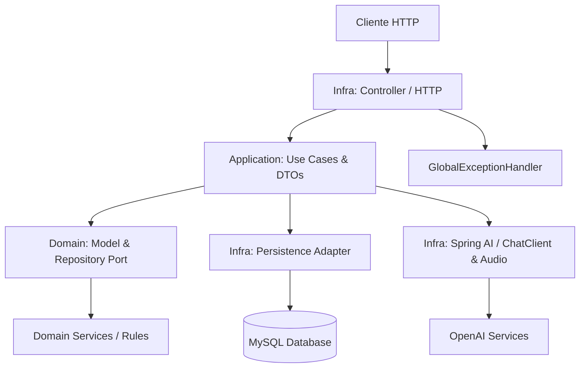
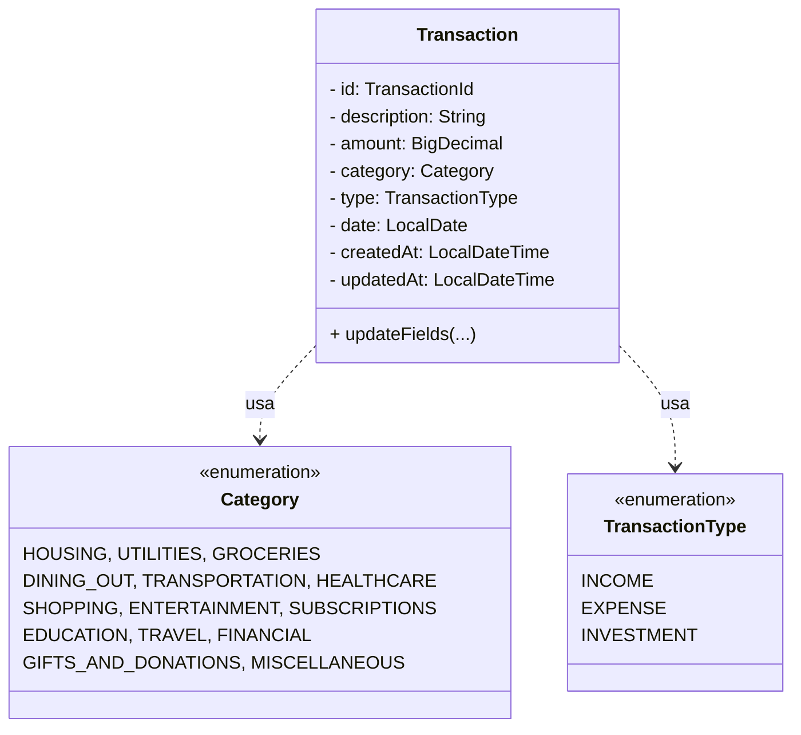

# 🤖 NestorAI API

> API RESTful desenvolvida com **Java 25 e Spring Boot 4** para gerenciamento de transações financeiras com suporte e assistência de Inteligência Artificial via **Spring AI e OpenAI (GPT-4o-mini / Whisper / TTS)**.
>
> Projeto desenvolvido no módulo de Inteligência Artificial do bootcamp **DIO — Itaú: Java com Inteligência Artificial**, com foco em decisões arquiteturais baseadas em **DDD (Domain-Driven Design)** com mesclas de **Arquitetura Hexagonal (Ports & Adapters)**, integração com modelos generativos e boas práticas de desenvolvimento backend.

---

## 📌 Visão Geral do Projeto

O **NestorAI** é uma aplicação voltada para o registro e controle de transações financeiras. O diferencial da aplicação é a inclusão de um assistente inteligente capaz de processar entrada de áudio do usuário, transcrevê-la, extrair os campos da transação de forma estruturada, validar a integridade das informações e responder em áudio gerado via síntese de voz (TTS) para prévia e confirmação.

### Principais funcionalidades

- **Assistente de Áudio / IA:** recepção de áudios em formato de voz, transcrição via OpenAI Whisper e interpretação contextual via GPT-4o-mini com prompt estruturado.
- **Prévia e Validação por Voz:** identificação de campos ausentes ou ambíguos, com geração de resposta em texto e sintese de voz (áudio em Base64) solicitando confirmação ou dados faltantes.
- **Gestão de Transações (CRUD REST):** criação, consulta filtrada (por categoria, tipo, data e período), atualização parcial e exclusão de transações.
- **Normalização e Regras de Negócio:** sanitização automática de valores positivos, descrições e datas relativas (ex: "hoje", "ontem", "anteontem").
- **Tratamento Global de Exceções:** tratamento refinado para erros de validação, arquivos de áudio inválidos, falhas de processamento em APIs de IA e recursos não encontrados.
- **Suíte de Testes Automatizados:** testes unitários e de integração de controllers (MockMvc) e casos de uso com JUnit 5 e Mockito.

---

## 🏛️ Arquitetura do Projeto

O projeto utiliza os princípios do **Domain-Driven Design (DDD)** combinados com preceitos de **Arquitetura Hexagonal (Ports & Adapters)**, isolando completamente o domínio das tecnologias de infraestrutura e frameworks HTTP/JPA.



### Responsabilidades e Camadas

- **Domain (Núcleo):** Contém as entidades de domínio (`Transaction`), Value Objects (`TransactionId`), Enums (`Category`, `TransactionType`) e as **Portas de Saída** (`TransactionRepository`). Não possui dependências com frameworks externos.
- **Application (Casos de Uso):** Contém a orquestração do negócio (`SaveTransactionUseCase`, `PrepareVoiceTransactionUseCase`, `UpdateTransactionUseCase`, etc.) e os DTOs internos de entrada e saída.
- **Infra: Http:** Controladores REST (`TransactionController`, `TransactionAiController`), DTOs de requisição/resposta, validações de áudio e manipulador global de erros.
- **Infra: Persistence:** Implementação concreta dos repositórios (`JpaTransactionRepository`), Mapeamento de Entidades JPA (`TransactionEntity`) e Spring Data Repositories.
- **Infra: AI Config:** Configuração dos Beans do Spring AI (`ChatClient`, `TranscriptionModel`, `TextToSpeechModel`).

---

## 🧩 Decisões Arquiteturais e Recursos Utilizados

### -> Domain-Driven Design (DDD) & Arquitetura Hexagonal
A entidade `Transaction` centraliza as mutações de seu estado via métodos encapsulados (ex: `updateFields`), garantindo que campos como `updatedAt` sejam manipulados internamente. A persistência é acessada exclusivamente via contrato da interface `TransactionRepository` (Port), cuja implementação concreta via JPA/Hibernate fica isolada na camada de infraestrutura (Adapter).

### -> Processamento de Linguagem Natural e Voz (Spring AI)
- **Transcrição (STT):** O áudio enviado pelo usuário é transcrevido utilizando o modelo Whisper da OpenAI.
- **Leitura Estruturada (Structured Output):** O `ChatClient` utiliza prompts com restrições e esquemas para converter a transcrição bruta diretamente para o DTO `VoiceTransactionFields`.
- **Síntese de Voz (TTS):** O retorno ao usuário inclui uma mensagem contextualizada traduzida para áudio codificado em Base64 para execução no cliente.

### -> DTO — Data Transfer Object & Record Types
Utilização ostensiva de Java `record` para transporte de dados imutáveis entre camadas (`TransactionInput`, `TransactionOutput`, `VoiceTransactionPreviewOutput`), evitando o acoplamento das entidades do banco de dados com a API pública.

### -> Repository Pattern & Adapter Pattern
Separação nítida entre o contrato do repositório no domínio e o adaptador JPA (`JpaTransactionRepository` adaptando `TransactionEntityRepository`).

### -> Injeção de Dependências e Imutabilidade
Uso do container IoC do Spring com injeção via construtor (potencializada pelo Lombok `@RequiredArgsConstructor`).

---

## 🗃️ Modelo de Dados



---

## 🛠️ Stack Tecnológica

| Componente | Tecnologia |
|---|---|
| Linguagem | Java 25 |
| Framework | Spring Boot 4.1.1 |
| Módulo de IA | Spring AI 2.0.0 (OpenAI Chat, Transcribe & TTS) |
| Persistência | Spring Data JPA / Hibernate |
| Banco de dados | MySQL 9.6 (via Docker) |
| Processamento de Dados | Jackson (JSON / JavaTime Module) |
| Validação | Jakarta Bean Validation |
| Utilitários | Lombok |
| Testes Automatizados | JUnit 5 / Mockito / Spring WebMvc Test |
| Containerização | Docker / Docker Compose / Spring Boot Docker Compose |
| Build Tool | Gradle |

---

## 🚀 Como Executar o Projeto

### Pré-requisitos

- Git
- Docker Desktop e Docker Compose
- JDK 25 instalado e configurado
- Chave de API da OpenAI (`OPENAI_API_KEY`)

### 1. Clonar o repositório

```bash
git clone https://github.com/LucasNs7/nestor-ai.git
cd nestor-ai
```

### 2. Configurar Variáveis de Ambiente

Crie um arquivo `.env` na raiz do projeto (ou configure no seu ambiente) contendo as seguintes chaves:

```env
MYSQL_DATABASE=
MYSQL_ROOT_PASSWORD=
MYSQL_USER=
MYSQL_PASSWORD=
MYSQL_PORT=
MYSQL_URL=
OPENAI_API_KEY=
```

### 3. Subir o Banco de Dados (MySQL)

```bash
docker compose up -d
```

### 4. Executar a Aplicação

No Linux/macOS:

```bash
./gradlew bootRun
```

No Windows:

```bash
gradlew.bat bootRun
```

A aplicação estará disponível em `http://localhost:8080`.

---

## 📑 Endpoints da API

### Transações via IA (Assistente de Voz)

| Método | Endpoint | Descrição |
| --- | --- | --- |
| `POST` | `/ai/transactions/voice` | Envia áudio da transação (`multipart/form-data`) para transcrição e interpretação pela IA |
| `POST` | `/ai/transactions/confirm` | Confirma e salva no banco a transação previamente analisada |

### Transações (CRUD Convencional)

| Método | Endpoint | Descrição |
| --- | --- | --- |
| `POST` | `/transactions` | Cadastra uma nova transação financeira |
| `GET` | `/transactions/category/{category}` | Lista transações por categoria (`HOUSING`, `GROCERIES`, etc.) |
| `GET` | `/transactions/type/{type}` | Lista transações por tipo (`INCOME`, `EXPENSE`, `INVESTMENT`) |
| `GET` | `/transactions/date/{date}` | Lista transações por data específica (`yyyy-MM-dd`) |
| `GET` | `/transactions?start={start}&end={end}` | Lista transações em um intervalo de datas |
| `PATCH` | `/transactions/{id}` | Atualização parcial dos dados da transação |
| `DELETE` | `/transactions/{id}` | Exclui uma transação por ID (UUID) |

---

## 💡 Decisões Arquiteturais e Boas Práticas

1. **Precisão Financeira com `BigDecimal`:** Todos os valores numéricos monetários utilizam `BigDecimal` para evitar problemas de arredondamento de Ponto Flutuante.
2. **Isolamento de Domínio (DDD):** O modelo do domínio não depende das anotações da JPA (`@Entity`, `@Table`), sendo convertido através da classe adaptadora `TransactionEntity`.
3. **Respostas em Áudio Sintetizado:** Integração do fluxo de confirmação por voz em Base64, permitindo que interfaces cliente reproduzam a instrução do assistente imediatamente.
4. **Resiliência e Tratamento de Erros:** Respostas de erro padronizadas via `@RestControllerAdvice` (`GlobalExceptionHandler`) mapeando exceções de negócio como `AudioProcessingException`, `InvalidAudioException`, e `ResourceNotFoundException`.
5. **Spring Boot Docker Compose Integration:** Integração nativa de ambiente de desenvolvimento facilitando a subida de dependências Docker durante o ciclo de build e testes.

---

## 🧪 Testes Automatizados

O projeto possui cobertura de testes unitários para a camada de serviço e testes de integração Web (MockMvc) para as rotas da API REST.

Para executar a suíte completa de testes:

```bash
./gradlew test
```

---

## 🎯 Objetivo do Projeto

Aplicar conceitos avançados de arquitetura backend com Java, focando em **Domain-Driven Design (DDD)**, **Arquitetura Hexagonal** e na inclusão prática de recursos de **Inteligência Artificial Generativa e Processamento de Áudio** do Spring AI, integrando modelos externos para automação da criação e persistência de transações no banco de dados.

---

<div align="center">

**Lucas**  
*Desenvolvedor Java Backend*

[LinkedIn](https://www.linkedin.com/in/lucas-ns7/) | [GitHub](https://github.com/LucasNs7)

---

*Projeto final da API inteligente desenvolvido como parte do Bootcamp da DIO: **Itaú - Java com Inteligência Artificial**.*

</div>